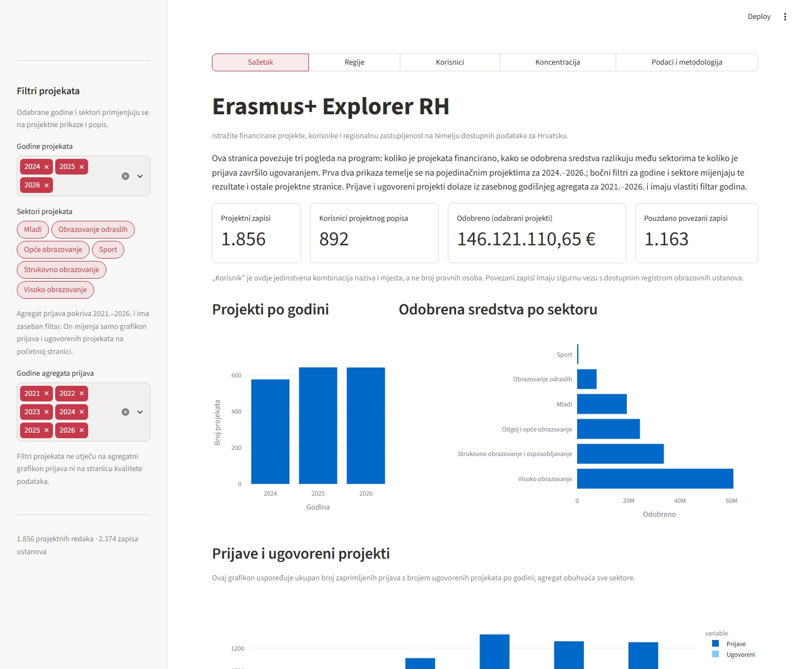
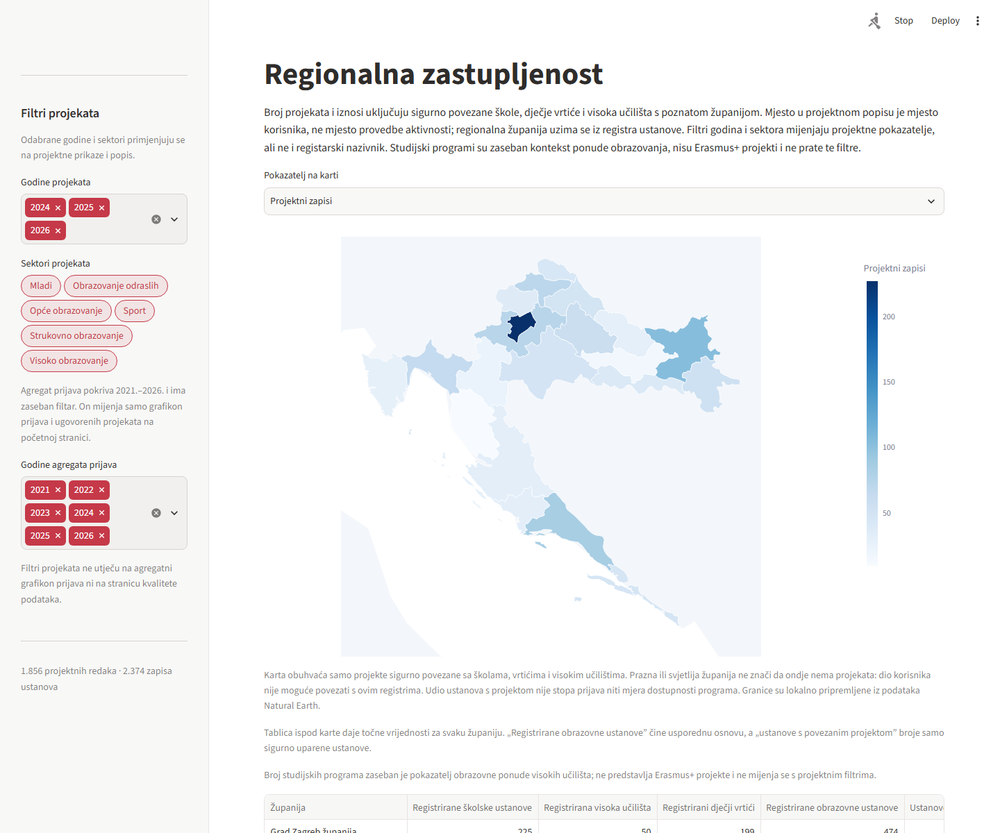
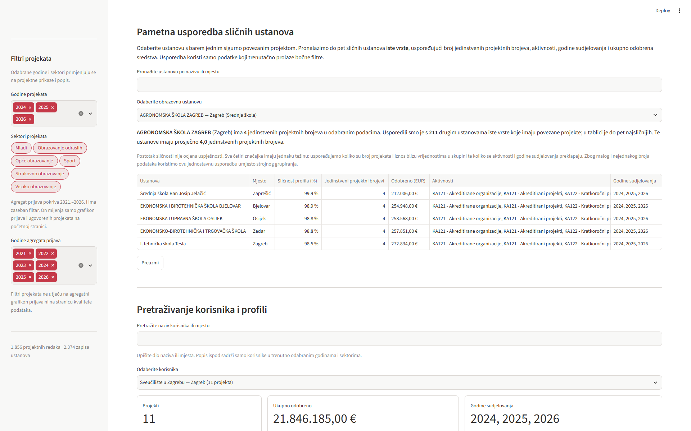

# Erasmus+ Explorer RH — dokumentacija za Datathon

## Sažetak rješenja

Erasmus+ Explorer RH je prototip za istraživanje financiranih Erasmus+ projekata
i sudjelovanja obrazovnih ustanova u Hrvatskoj. Povezuje popis projekata,
agregate prijava i financiranja te registre škola i visokih učilišta. Služi kao
informacijski alat za obrazovne ustanove, javnu upravu, istraživače i građane koji
žele razumjeti gdje su evidentirani korisnici projekata, koje vrste ustanova
sudjeluju i koliko je financiranje koncentrirano.

Rješenje ne procjenjuje kvalitetu pojedinih ustanova niti uzročni učinak programa.
Analizira zabilježeno sudjelovanje i financiranje, ali ne mjeri potpunu dostupnost
Erasmus+ prilika niti objašnjava uzroke regionalnih ili sektorskih razlika. Broj
projekata nije isto što i vjerojatnost uspjeha ili dostupnost prilike; za takve
zaključke trebali bi, među ostalim, podaci o prijavama i odbijenim prijavama po
ustanovi te usporedivi podaci o veličini i broju ustanova.

## Pitanje i javna korist

Jesu li financirani Erasmus+ projekti i iznosi ravnomjerno raspoređeni među
obrazovnim sektorima, vrstama ustanova i hrvatskim županijama — i koliko je
pouzdano to moguće zaključiti iz javno dostupnih podataka?

Analiza pomaže uočiti obrasce zabilježenog sudjelovanja, ponovljene korisnike,
regionalne razlike i praznine u podacima. Ustanove mogu pronaći usporedive
korisnike i vidjeti gdje su evidentirani projekti. Javna uprava može prepoznati
gdje vrijedi prikupiti dodatne podatke ili istražiti potrebu za informativnom
podrškom. Rezultati su pokazatelji za daljnje istraživanje, a ne mjera potpune
dostupnosti Erasmus+ mogućnosti, dokaz nejednakog pristupa ili objašnjenje uzroka
razlika.

## Funkcionalnosti prototipa

- Pregled financiranih projektnih zapisa, iznosa po sektoru i agregatnih prijava
  i ugovorenih projekata.
- Regionalna karta i tablica za škole, dječje vrtiće i visoka učilišta: projekti, sredstva,
  registarski nazivnici te broj studijskih programa po županiji kao kontekst
  obrazovne ponude.
- Usporedba registarskih i povezanih ustanova prema vrsti ustanove, s brojem
  korisnika, projektnim zapisima, jedinstvenim projektnim brojevima i iznosima.
- Pretraživanje profila korisnika, analiza koncentracije financiranja i preuzimanje
  filtriranih projektnih, regionalnih i institucionalnih tablica te obrađenih
  analitičkih skupova u XLSX formatu.
- Pametna usporedba odabrane obrazovne ustanove s do pet najsličnijih ustanova
  iste vrste, prema broju projekata, aktivnostima, godinama sudjelovanja i
  odobrenim sredstvima; način izračuna i broj usporedivih ustanova vidljivi su
  uz rezultat.
- Prikaz kvalitete podataka, nepodudarnosti izvora i metodologije; na istoj
  stranici nalazi se i filtrirani popis projekata.

Sučelje je namijenjeno i osobama koje ne rade svakodnevno s analizom podataka:
uz prikaze su kratka objašnjenja ključnih mjera i načina čitanja. Granice podataka
i metodološka ograničenja navedeni su odvojeno na stranici „Podaci i metodologija”.

## Snimke zaslona sučelja

Početni pregled povezuje financirane projektne zapise s agregatima prijava i
ugovaranja. Regionalna karta i tablica zatim prikazuju prostorni raspored
sigurno povezanih ustanova; gumb **Preuzmi** uz tablicu sprema XLSX s brojčanim
vrijednostima.





Na stranici korisnika moguće je usporediti ustanovu s drugim ustanovama istog
tipa. Usporedba prikazuje značajke, broj uključenih ustanova i ograničenja
metode, a tablica se može preuzeti u Excel.



## Izvori podataka i metapodaci

Lokalne podatkovne datoteke preuzete su 6. studenoga 2026. Kataloški metapodaci
provjereni su 7. studenoga 2026. U nastavku su kataloške kartice, izdavači,
licence prikazane u CKAN-u i lokalne datoteke. Datum izmjene odnosi se na
metapodatke kartice, ne nužno na sadržaj svake lokalne CSV snimke.

Svaka lokalna CSV snimka preuzeta je izravno s odgovarajućeg CKAN skupa ili
njegova resursa navedenog u tablici ispod; izvorne datoteke nisu naknadno
filtrirane, ručno skraćivane niti prepravljane. Skripta učitava te snimke i
priprema podatke za analizu:
pretvara tipove vrijednosti, normalizira tekst radi povezivanja te izrađuje
izvedene sažetke. Filtri u aplikaciji su interaktivni i mijenjaju samo prikaz,
ne sadržaj preuzetih izvornih CSV datoteka. Iznimke i opseg izvedenih tablica
objašnjeni su u odjeljku analize ulaznih tablica.

| Kataloški skup | Lokalna datoteka i uloga | Izdavač | Licencija u katalogu | Izmjena metapodataka |
|---|---|---|---|---|
| [Program Erasmus+ 2021.–2027.](https://data.gov.hr/ckan/hr/dataset/program-erasmus-za-razdoblje-od-2021-do-2027-godine) ([CSV projekata](https://data.gov.hr/ckan/dataset/8212ac19-861e-4a41-b2fa-cc66bdbda907/resource/74a703c5-9b28-4868-88a5-984c928c5070/download/tablica_7_popis-financiranih-projekata-programa-erasmus_2021_2027.csv)) | `tablica_7_...csv`: pojedinačni projekti, korisnik, sektor, godina i iznos. | Agencija za mobilnost i programe Europske unije | Otvorena dozvola (OD) | 9. 10. 2026. |
| [Program Erasmus+ — isti skup](https://data.gov.hr/ckan/hr/dataset/program-erasmus-za-razdoblje-od-2021-do-2027-godine) ([CSV financija](https://data.gov.hr/ckan/dataset/8212ac19-861e-4a41-b2fa-cc66bdbda907/resource/5af3727b-30dc-4d34-8009-2d74bebb2bd4/download/tablica_8_pregled-financijskih-rezultata-programa-erasmus-2021_2027.csv)) | `tablica_8_...csv`: agregatni financijski rezultati i usklađenje iznosa. | Agencija za mobilnost i programe Europske unije | Otvorena dozvola (OD) | 9. 10. 2026. |
| [Program Erasmus+ — isti skup](https://data.gov.hr/ckan/hr/dataset/program-erasmus-za-razdoblje-od-2021-do-2027-godine) ([CSV prijava i ugovaranja](https://data.gov.hr/ckan/dataset/8212ac19-861e-4a41-b2fa-cc66bdbda907/resource/8ab34131-385a-4e08-a883-151d5054f112/download/tablica_9_broj-erasmus-zaprimljenih-i-odobrenih-projekata-2021_2027.csv)) | `tablica_9_...csv`: broj prijava i ugovorenih projekata te agregatne stope. | Agencija za mobilnost i programe Europske unije | Otvorena dozvola (OD) | 9. 10. 2026. |
| [Osnovne škole](https://data.gov.hr/ckan/hr/dataset/osnovne-skole) | `data (1).csv`: podaci o osnovnim školama za povezivanje i klasifikaciju. | Ministarstvo znanosti, obrazovanja i mladih | Otvorena dozvola (OD) | 15. 4. 2026. |
| [Srednje škole](https://data.gov.hr/ckan/hr/dataset/srednje-skole) | `data.csv`: podaci o srednjim školama za povezivanje, vrstu i županiju. | Ministarstvo znanosti, obrazovanja i mladih | Otvorena dozvola (OD) | 15. 4. 2026. |
| [Ustanove iz sustava visokog obrazovanja](https://data.gov.hr/ckan/hr/dataset/ustanove-iz-sustava-visokog-obrazovanja) | `data (2).csv`: registar ustanova za povezivanje i klasifikaciju visokih učilišta; mjesto se koristi za izvedbu županije. | Ministarstvo znanosti, obrazovanja i mladih | Otvorena dozvola (OD) | 15. 4. 2026. |
| [Studijski programi visokih učilišta](https://data.gov.hr/ckan/dataset/studijski-programi-visokih-ucilista) | `data (3).csv`: studijski programi povezani s registrom ustanova po izvođaču i mjestu te agregirani po županiji kao kontekst obrazovne ponude. | Ministarstvo znanosti, obrazovanja i mladih | Otvorena dozvola (OD) | 15. 4. 2026. |
| [Dječji vrtići](https://data.gov.hr/ckan/hr/dataset/djecji-vrtici) ([CSV resurs](https://data.gov.hr/ckan/dataset/0b951eaa-d9e7-4c68-adcf-5090f452abf4/resource/7e7c26cd-6ad4-4cdd-b0cb-42b0ad2a933c/download/data.csv)) | `data (4).csv`: 885 zapisa dječjih vrtića i drugih pravnih osoba koje provode predškolske programe; koristi se za povezivanje projekata. | Ministarstvo znanosti, obrazovanja i mladih | Otvorena dozvola (OD) | Kartica: 15. 4. 2026.; CSV-resurs: 19. 5. 2025. |

CKAN u pregledanim karticama navodi [Otvorenu dozvolu RH](https://data.gov.hr/id/licence/otvorena-dozvola-rh). Prije daljnje
distribucije provjerite tekst dozvole i obveze atribucije. Datum preuzimanja
lokalnih datoteka je 6. studenoga 2026.; datum provjere kataloških metapodataka
je 7. studenoga 2026. Aplikacija radi nad lokalnim snimkama i ne dohvaća
podatke uživo.

## Analiza ulaznih tablica

Brojevi zapisa u nastavku ne uključuju zaglavlje CSV-a. Izvorne datoteke nisu
prepravljane; čišćenje i normalizacija rade se u pripremi podataka, a izvorni
redci ostaju sačuvani. Iznosi u europskom formatu pretvaraju se u numeričke
vrijednosti, a nazivi i mjesta normaliziraju se za sigurno povezivanje.
Projektni brojevi čuvaju se kao tekst, bez automatskog mijenjanja ili uklanjanja.

| Ulazna tablica | Što sadrži i nalaz | Obrada, ograničenja i veza s analizom |
|---|---|---|
| `tablica_7_popis-financiranih-projekata…csv` | 1.856 zapisa pojedinačnih financiranih projekata, s godinom, sektorom, korisnikom, mjestom, aktivnošću, projektnim brojem, odobrenim iznosom i datumom ažuriranja. Ima 1.855 različitih projektnih brojeva. | Decimalni zarezi i iznosi s oznakom EUR parsiraju se u brojeve; godina, naziv/mjesto i identifikatori se normaliziraju. Projektni broj `2024-2-HR01-KA155-YOU-000267618` pojavljuje se dvaput: uz korisnike „SUMA – Udruga za održivi razvoj” i „Natura i kultura”. Oba retka su zadržana jer se razlikuju korisnici; nije dokazano da je jedan duplikat za brisanje. Ovo je jedina tablica na razini pojedinačnog projekta i temelj je korisničkih, regionalnih i koncentracijskih prikaza. |
| `tablica_8_pregled-financijskih-rezultata…csv` | Godišnji agregati raspoloživih, ugovorenih i realiziranih sredstava te postoci, razvrstani po sektoru i ukupno; dostupni agregati obuhvaćaju 2021.–2026. | Agregatna je tablica, nije popis projekata niti korisnika. Služi za pregled raspodjele kroz razdoblje i provjeru ukupno ugovorenog iznosa prema pojedinačnoj tablici projekata. Tablica i popis mogu imati različit datum ažuriranja, pa se razlike prikazuju, a ne ispravljaju automatski. |
| `tablica_9_broj-erasmus-zaprimljenih-i-odobrenih…csv` | Agregatni broj prijava i ugovorenih projekata prema godini, ključnoj aktivnosti i sektoru, uz objavljene stope. Pokriva 2021.–2026. | Nema korisnika ni projektnih brojeva, pa se ne može izravno povezati s registrom ustanova niti s pojedinačnim projektima. Koristi se za grafikon prijava i ugovaranja te usporedbu godišnjeg broja ugovorenih projekata. |
| `data (1).csv` — osnovne škole | 926 zapisa škola, s nazivom, mjestom, adresom, županijom i vrstom ustanove. | Povezivanje koristi jedinstven normalizirani naziv; ako se mjesto razlikuje, veza se prihvaća samo kad naziv upućuje na jednu registriranu ustanovu. Adresa može razriješiti skraćeni naziv kad se jedinstveno podudara. |
| `data.csv` — srednje škole | 443 zapisa srednjih škola s mjestom, adresom, županijom i vrstom ustanove; postoje i kombinirane vrste koje obuhvaćaju više razina obrazovanja. | Kombinirane vrste se u prikazu grupiraju zasebno kako ustanova ne bi ulazila u više nazivnika. Vrsta i županija dolaze iz registra; adresa pomaže razriješiti jedinstveni kratki naziv korisnika. |
| `data (2).csv` — ustanove visokog obrazovanja | 133 zapisa ustanova visokog obrazovanja, uključujući naziv, mjesto i vrstu ustanove. | Županija se dodjeljuje samo ako mjesto ustanove ima točno jednu županiju u školskim registrima. U ovom presjeku svih 133 mjesta imaju jednoznačnu vezu. To omogućuje da i projekti sigurno povezani s visokim učilištima uđu u regionalnu analizu. |
| `data (3).csv` — studijski programi | 1.727 zapisa programa s nazivom, ECTS-om, trajanjem, izvođačem/nositeljem, mjestom i akademskim stupnjem. | 1.709 zapisa sigurno je povezano s registarskim visokim učilištem po normaliziranom nazivu izvođača i mjestu; svih 1.709 dobiva županiju. Preostalih 18 nije povezano s ustanovom i izostavljeno je iz županijskih zbrojeva studija. Broj programa je kontekst obrazovne ponude, ne mjera Erasmus+ sudjelovanja ili financiranja. |
| `data (4).csv` — dječji vrtići | 885 zapisa iz CSV-resursa CKAN-a s nazivom, adresom, mjestom i županijom. Skup obuhvaća i druge pravne osobe koje provode predškolske programe. | Koristi se za povezivanje predškolskih ustanova s projektnim korisnicima i njihovo uključivanje u usporedbu vrsta i regija. Izdavač je Ministarstvo znanosti, obrazovanja i mladih; katalog navodi Otvorenu dozvolu (OD). |

Četiri registra ustanova sadrže ukupno 2.387 izvornih redaka, konsolidiranih u
2.374 ustanove radi uklanjanja ponovljenih registarskih zapisa. Županije visokih
učilišta izvedene su iz mjesta preko školskih registara samo kad je mjesto
jednoznačno povezano s jednom županijom. Projekt se povezuje kad se naziv i mjesto točno
podudaraju, kad jedinstven naziv upućuje na jednu ustanovu neovisno o razlici u
mjestu, kad je jedinstven registarski naziv naveden uz isto mjesto na kraju
naziva korisnika, ili kad skraćeni naziv i točna adresa daju jedinstvenu vezu.
Uz ta automatska pravila korisnica je potvrdila još 45 povezivanja osnovnih škola
prema nazivu, mjestu i pregledu registarskih kandidata. Tri projektna zapisa
talijanske ili dvojezične škole u Rovinju ostaju nepovezana jer se ne mogu
sigurno spariti s odgovarajućim registrom. U ovom presjeku 1.163 projektna
zapisa imaju povezanu ustanovu, a za 693 nije pronađen potvrđen kandidat u ovim
registrima. Dodatno je povezano 34 zapisa u kojima je naziv ustanove bio točan,
ali je mjesto bilo dodano na kraj naziva korisnika, ili su se jedinstvena točna
adresa i naziv ustanove podudarali. Među njima su III. gimnazija Zagreb i više
dječjih vrtića. Svih 44 ranije izdvojenih razlika u mjestu
sada su povezane jedinstvenim nazivom ili točnom adresom; pet redaka pod kratkim
nazivom „Tehnička škola” adresom Eugena Kumičića 55 povezano je s Tehničkom
školom u Slavonskom Brodu. Mjesto u projektnom popisu označava mjesto korisnika,
ne nužno mjesto provedbe aktivnosti. Nepovezivanje nije dokaz da korisnik ne
postoji; registri ne pokrivaju sve vrste korisnika. Ne primjenjuje se automatsko
fuzzy povezivanje; 45 ručno potvrđenih školskih veza izričito je evidentirano.
Nakon njihova povezivanja i dodatnog povezivanja zapisa koji imaju točan naziv
uz dodano mjesto ili jedinstvenu točnu adresu, 138 zapisa obrazovnih sektora
još nije povezano;
među preostalim zapisima iz obrazovanja odraslih, mladih i sporta 555 nema
potvrđene veze. Ti zapisi nisu uklonjeni.

Prethodni popis 561 zapisa iz obrazovanja odraslih, mladih i sporta imao je 328
različitih normaliziranih naziva korisnika. Nakon povezivanja jedinstvenih
podudaranja ostalo je 555 nepovezanih projektnih zapisa i 326 različitih
normaliziranih tekstualnih naziva među njima. Primjerice, ako se isti naziv
korisnika pojavi u tri projekta, to su tri projektna zapisa, ali jedan naziv
u broju 326. Razlike samo u velikim slovima, dijakritici ili interpunkciji
nakon čišćenja ne stvaraju novi naziv. Broj 326 zato nije broj ustanova:
različite ustanove mogu imati isti naziv, a ista ustanova može biti zapisana
pod dovoljno različitim nazivima da se broje odvojeno.

U usporedbi izvora za godine u kojima postoji projektni popis, 2024. broj se
podudara (575), ali se iznos razlikuje za **+312.097 EUR** u popisu projekata
prema financijskom agregatu. Za 2025. popis ima **641** zapis, a agregat
ugovaranja **642**; iznos popisa manji je za **307.606,12 EUR**. Za 2026. broj
(640) i iznos (**50.706.031,90 EUR**) podudaraju se. Mogući razlozi poput
različitih datuma presjeka ili načina agregiranja ne mogu se potvrditi samo iz
datoteka, zato su razlike označene za provjeru i nijedan izvor nije tiho
prepravljan.

## Metodologija i tumačenje pokazatelja

- **Projektni zapis** je redak u popisu financiranih projekata. Projektni broj se
  čuva kao poseban pokazatelj; ponovljeni broj se ne uklanja automatski jer
  izvorni redci mogu imati različite korisnike.
- **Normalizirani naziv** je naziv prilagođen za usporedbu: slova se ujednačuju,
  dijakritički znakovi i interpunkcija uklanjaju, a kratice OŠ, SŠ i DV
  proširuju. Tako se nebitne razlike u zapisu ne tretiraju kao različiti nazivi.
  Korisnik se grupira prema takvom nazivu i mjestu.
- Različit broj projektnih redaka i jedinstvenih naziva korisnika ne znači
  jednak broj pravnih osoba. „Jedinstveni nazivi” broje tekstualne oznake nakon
  normalizacije; više organizacija može imati sličan naziv, a ista organizacija
  može biti zapisana pod različitim nazivima.
- **Pouzdana veza s registrom** postoji kad naziv i mjesto daju jedinstvenu vezu,
  kad je normalizirani naziv jedinstven u registru neovisno o mjestu, ili kad
  se skraćeni naziv može razriješiti jedinstvenom točnom adresom. Ako ostane
  više kandidata, zapis se ne povezuje automatski.
- **Sličnost obrazovnih ustanova** nije model koji ustanove svrstava u unaprijed
  zadane skupine niti ocjena njihove kvalitete. Za odabranu ustanovu prvo se
  izdvoje druge ustanove iste vrste koje imaju barem jedan sigurno povezani
  projekt u trenutno odabranim godinama i sektorima. Prikazuju se sve pronađene
  ustanove do najviše pet, pa se rezultat vidi i kada postoji samo jedna ili
  nekoliko usporedivih ustanova. Za brojčane pokazatelje – projekte i iznos –
  sličnost veća je što su vrijednosti bliže jedna drugoj u uspoređenoj skupini.
  Za aktivnosti i godine računa se Jaccardov omjer. Četiri pokazatelja imaju
  jednaku težinu pri izračunu ukupnog postotka sličnosti.
- **Jaccardov omjer** jednostavno mjeri preklapanje dvaju popisa: broj zajedničkih
  stavki dijeli se brojem svih različitih stavki u oba popisa. Primjerice, ako
  jedna ustanova ima aktivnosti A i B, a druga A i C, zajednička je jedna od
  ukupno tri različite aktivnosti, pa je omjer 1/3. Ista se logika primjenjuje
  na godine sudjelovanja.
- **Postotak sličnosti** je usporedni rezultat za četiri navedena pokazatelja,
  a ne ocjena uspješnosti ustanove. Uz njega se prikazuju i izvorne vrijednosti
  kako bi korisnik mogao vidjeti na čemu se usporedba temelji.
- **Vrsta ustanove** izvedena je iz vrste u registru. Kombinirane vrste škola
  prikazuju se kao zasebna kategorija kako ista ustanova ne bi bila više puta
  uračunata u nazivnik, odnosno u ukupni broj ustanova s kojim se uspoređuje
  broj ustanova s projektom. Visoka učilišta određuju se prema vrsti registra.
- **Udio ustanova s povezanim projektom** računa broj jedinstvenih ustanova iz
  registra koje imaju projekt u odabranom skupu podijeljen ukupnim brojem
  jedinstvenih škola, vrtića i visokih učilišta u registru županije. To je pokrivenost
  dostupnog registra odabranim popisom, a ne stopa prijava, odobravanja ili
  stvarne dostupnosti programa.
- Regionalni projektni prikaz uključuje pouzdano povezane škole, dječje vrtiće
  i visoka učilišta s pridruženom županijom. Županija za visoka učilišta izvedena je iz
  mjesta koje se jednoznačno podudara sa školskim registrom; mjesta s više
  mogućih županija ne koriste se za tu dopunu.
- Studijski programi povezuju se s visokim učilištem samo po jedinstvenom
  normaliziranom nazivu izvođača i mjestu; broj se zatim agregira po županiji.
  To je odvojeni kontekst ponude studija, ne veza studija s Erasmus+ projektima.
- Pojedinačni projektni popis pokriva 2024.–2026.; agregati prijava pokrivaju
  2021.–2026. Te vremenske serije nisu izravno usporedive.
- Razlike između popisa projekata i agregatnih tablica te ponovljeni projektni
  brojevi objavljuju se kao upozorenja. Nema tihog odbacivanja zapisa.

## Tehnička arhitektura i pokretanje

`2021-2027/prepare_data.py` učitava lokalne CSV datoteke, validira obvezna polja,
normalizira nazive, povezuje projekte i ustanove te zapisuje JSON/CSV rezultate
u `2021-2027/processed/`. `2021-2027/streamlit_app.py` prikazuje analize nad tim
rezultatima. Pomoćne agregacije nalaze se u `2021-2027/app_helpers.py`.

### Osvježavanje podataka i proširenje

U ovoj verziji podaci se osvježavaju ručno: CSV-resursi su preuzeti izravno s
poveznica u tablici izvora, ali aplikacija ih još ne dohvaća sama s CKAN-a niti
se automatski osvježava. U nastavku su mogući smjerovi daljnjeg razvoja; oni
nisu dio trenutačne funkcionalnosti prototipa.

- **Izravno i kontrolirano preuzimanje:** dohvat najnovijih datoteka s CKAN
  resursa, uz evidentiranje datuma preuzimanja, provjeru strukture i obveznih
  polja te čuvanje izvorne snimke prije obrade. Promjene bi se prvo prikazale
  kao upozorenja, a ne bi neprimjetno zamijenile podatke.
- **Proširenje na razdoblje 2014.–2020.:** pronaći i provjeriti odgovarajuće
  izvore te mapirati njihove podatke na zajedničku strukturu. Usporedbe s
  razdobljem 2021.–2027. zahtijevale bi jasno označavanje razlika u pravilima,
  definicijama, sektorima i dostupnosti podataka; ne bi se pretpostavljalo da su
  pokazatelji iz oba razdoblja izravno usporedivi.
- **Potpuniji nazivnici i podaci o prijavama:** povezati broj projekata i iznose
  s usporedivim podacima o broju ustanova, učenika ili studenata, gdje su
  dostupni. Dodati prijave, odobrene i odbijene projekte na razini ustanove
  samo ako izvor takve podatke pruža, kako bi se bolje istraživalo sudjelovanje
  i uspješnost prijava.
- **Proširenje registara i obuhvata korisnika:** uključiti nove javne registre
  i vrste organizacija koje sudjeluju u programu, uz zasebna i provjerljiva
  pravila povezivanja. Nesigurne podudarnosti trebale bi ostati označene za
  provjeru, ne potvrđivati se automatski.
- **Praćenje promjena kroz vrijeme i dostupniji rezultati:** sačuvati više
  vremenskih presjeka radi prikaza promjena te, prema potrebi, ponuditi javni
  API ili redovito objavljene obrađene skupove podataka.

Takva proširenja trebala bi čuvati izvornu datoteku i trag obrade te prikazivati
obuhvat, datum i ograničenja svakog skupa. Ni prošireni podaci sami po sebi ne bi
dokazali dostupnost prilika ni uzrok razlika; za to bi i dalje bili potrebni
odgovarajući podaci o prijavama, odbijanjima i populaciji ustanova.

Za novi presjek podataka potrebno je preuzeti novije CSV-resurse s poveznica u
tablici izvora, zamijeniti odgovarajuće lokalne ulazne datoteke u
`2021-2027/` uz nazive koje očekuje `prepare_data.py`, zabilježiti datum
preuzimanja i provjeriti jesu li zaglavlja/obvezna polja promijenjena. Zatim
iz korijena repozitorija pokrenuti:

```powershell
python .\2021-2027\prepare_data.py
python -m unittest discover -s .\2021-2027 -p "test_*.py"
python -m streamlit run .\2021-2027\streamlit_app.py
```

Prva naredba ponovno gradi obrađene datoteke u
`2021-2027/processed/`; aplikacija ih čita iz tih JSON/CSV izlaza. Treba
provjeriti stranicu kvalitete podataka, broj povezivanja, usporedbu izvornih
zbrojeva i prikaze u aplikaciji prije objave novog presjeka. Izvorne CSV snimke
ostaju zasebne od obrađenih rezultata i ne treba ručno mijenjati JSON-ove.

Za proširenje na druge godine ili programska razdoblja potrebno je dodati
odgovarajuće projektne i agregatne resurse, utvrditi njihova polja i mapirati
ih na zajedničku strukturu projektnog zapisa. Projektno razdoblje treba ostati zasebnim filtrom ili metapodatkom kako se
podaci iz razdoblja s različitim pravilima ne bi neprimjetno zbrajali. Za nove
javne registre potrebno je dodati ulazne datoteke, provjeru strukture, pravila
normalizacije i povezivanja, referencu na izvor te testove kvalitete. Nesigurne
veze trebaju ostati odvojene, a ne automatski potvrđene. Na taj način struktura
rezultata u `processed/` može ostati stabilna za sučelje i kad se izvori
proširuju. Trenutačna verzija nema CKAN API, zakazano osvježavanje ni javni API.

Iz korijena repozitorija:

```powershell
python -m pip install -r .\requirements.txt
python .\2021-2027\prepare_data.py
python -m streamlit run .\2021-2027\streamlit_app.py
```

Testovi:

```powershell
python -m unittest discover -s .\2021-2027 -p "test_*.py"
```

Priprema podataka koristi Python standardnu biblioteku; aplikacija koristi
Streamlit, pandas, Plotly i openpyxl. Rezultati su dostupni kao JSON/CSV za daljnju
integraciju. Trenutna verzija nema javni API, zakazano osvježavanje ni
automatizirano dohvaćanje podataka.
