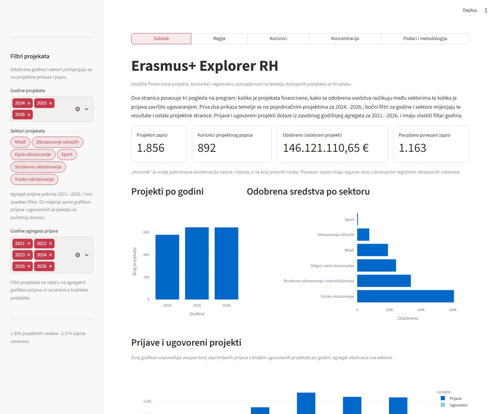
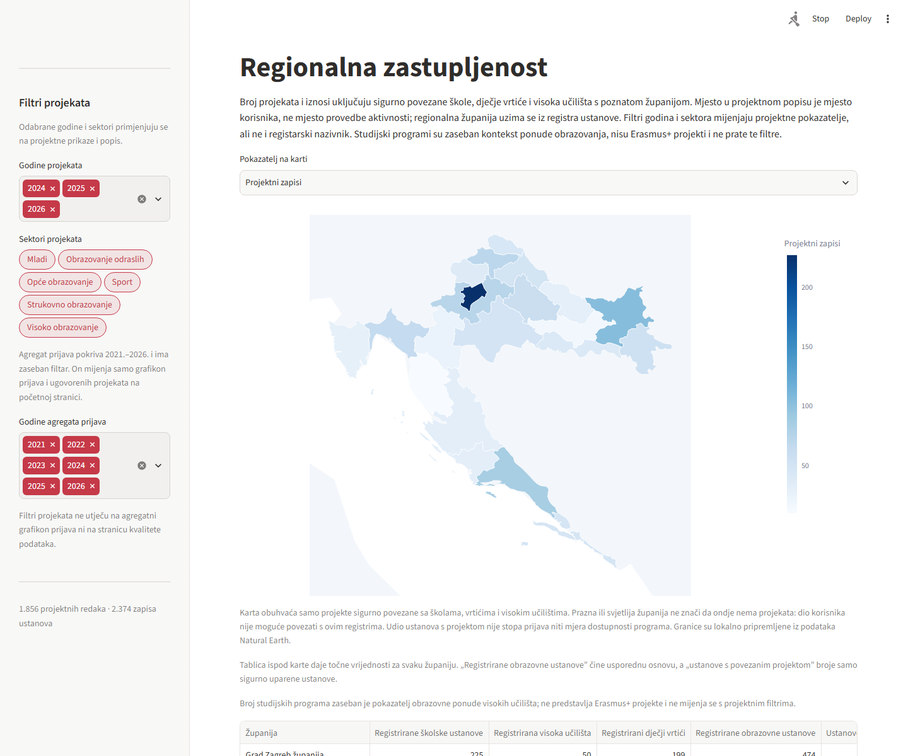
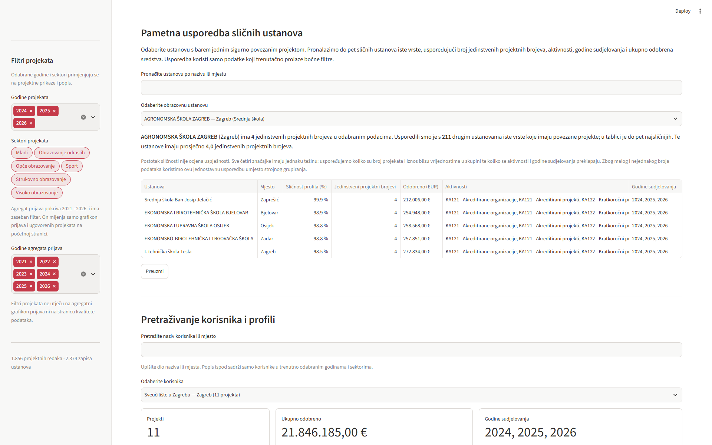

# Erasmus+ Explorer RH

Erasmus+ Explorer RH omogućuje pregled financiranih projekata, organizacija i regionalne
zastupljenosti te analizu koncentracije financiranja. Projekt istražuje obrasce
zabilježenog sudjelovanja; ne mjeri potpunu dostupnost Erasmus+ prilika niti uzroke
razlika. Projekt sadrži pripremu podataka i Streamlit MVP sučelje; izlazne JSON/CSV
datoteke ostaju dostupne za integraciju s drugim sučeljem, a tablični prikazi mogu
se preuzeti u XLSX formatu.

Dokumentacija projekta, metodologija, pregled natječajnih kriterija i predloženi
tijek trosminutne demonstracije nalaze se u [DATATHON.md](./DATATHON.md).

## Pokretanje aplikacije

Iz korijena projekta:

```powershell
python -m pip install -r .\requirements.txt
python .\2021-2027\prepare_data.py
python -m streamlit run .\2021-2027\streamlit_app.py
```

Aplikacija sadrži pregled programa, regionalnu analizu, pretraživanje organizacija i
ustanova, koncentraciju financiranja, filtrirani popis projekata te prikaz kvalitete
i ograničenja podataka.

## Korištenje umjetne inteligencije

AI-pomoćnik korišten je tijekom razvoja kao podrška izradi i doradi koda,
testova i dokumentacije. AI nije ugrađen u aplikaciju niti donosi analitičke
zaključke: podaci se obrađuju prema dokumentiranim pravilima, a usporedba
ustanova računa se transparentnim formulama.

## Snimke zaslona

Početna stranica daje pregled projekata, financiranja i prijava; regionalna karta
zatim prikazuje gdje su sigurno povezane ustanove zastupljene u dostupnim podacima.



Na stranici Regije uz kartu je tablica s brojčanim vrijednostima po županijama,
a gumb **Preuzmi** sprema trenutačni regionalni sažetak u Excel.



Usporedba ustanova pomaže posjetitelju staviti rezultate odabrane ustanove u kontekst
sličnih ustanova istog tipa. Prikazane značajke i ograničenja objašnjeni su uz tablicu.



## Priprema podataka

Za ponovno generiranje pripremljenih podataka:

```powershell
python .\2021-2027\prepare_data.py
```

Skripta koristi samo Python standardnu biblioteku. Rezultati se zapisuju u
`2021-2027/processed/`. Za pokretanje aplikacije potrebni su paketi iz
`requirements.txt`. Za provjeru pripreme i osnovnih pravila povezivanja:

```powershell
python -m unittest discover -s .\2021-2027 -p "test_*.py"
```

## Izlazne datoteke

- `projects.json` / `projects.csv` — jedan zapis po retku izvornog popisa; iznos je
  numerički `grant_amount_eur`, godina je broj, a `record_id` jedinstveno identificira
  redak čak i kad se projektni broj ponavlja.
- `beneficiaries.json` — profil po normaliziranom nazivu organizacije i mjestu, s brojem
  projekata, ukupnim iznosom, godinama, sektorima i vezama na zapise projekata.
- `institutions.json` — ustanove iz školskih, predškolskih i visokih registara. Zrcalni zapisi spajaju
  se samo kad se podudaraju normalizirani naziv, mjesto, adresa i poštanski broj;
  sačuvane su reference na izvorne retke.
- `project_institution_matches.json` / `.csv` — rezultat povezivanja svakog projekta
  s registrom i mogući kandidati.
- `regional_summary.json` — županijski zbrojevi za projekte sigurno povezane sa školskim,
  predškolskim i visokoškolskim registrom; županije visokih učilišta izvode se samo iz
  jednoznačnog podudaranja mjesta sa školskim registrom.
- `funding_results.json` — financijski rezultati po godini, mjeri i sektoru iz tablice 8.
- `application_results.json` — prijave, ugovoreni projekti i stope prolaznosti po godini,
  ključnoj aktivnosti i sektoru iz tablice 9.
- `dashboard_summary.json` — sažeti pokazatelji za početni prikaz.
- `data_quality.json` — provjere, duplikati i ograničenja podataka.

U korijenu repozitorija nalazi se i [dodatna kontrolna tablica za pregled
povezivanja i nepovezanih zapisa](./pregled_nepovezanih_erasmus_zapisa_azurirano_skole_vrtici_2026-11-08.xlsx).
To je dopunski pregled stanja na dan 8. 11. 2026., a ne ulazna datoteka
aplikacije; njezin sadržaj i uloga objašnjeni su u
[Datathon dokumentaciji](./DATATHON.md).

U `data_quality.json` nalazi se i godišnja usporedba broja projekata i financiranja
iz popisa projekata s agregatnim tablicama prijava i financija. Razlike su upozorenja
za pregled, ne automatski razlog za uklanjanje zapisa.

## Što prikazuje sučelje

- **Sažetak** — ključni pokazatelji, projekti po godini, sredstva po sektoru te
  agregatni broj prijava i ugovorenih projekata.
- **Regije** — županijski prikaz projekata sigurno povezanih sa školama, vrtićima
  i visokim učilištima, uz usporedbu s brojem ustanova u registru. U regionalnoj
  tablici stupac **Broj različitih projekata** broji različite projektne brojeve.
- **Organizacije i ustanove** — usporedba sudjelovanja prema vrsti ustanove te
  grafički prikaz usporedbe prema vrsti ustanove te pretraživi profili organizacija
  iz popisa projekata, s odvojenim prikazom sigurnih veza na registre
  i usporedbom odabrane ustanove s drugim ustanovama iste vrste sličnog Erasmus+
  profila.
- **Financiranje** — udio ukupnog financiranja vodećih organizacija i broj organizacija s više projekata.
- **Podaci i metodologija** — izvori, pravila povezivanja i kvaliteta podataka,
  uz pretraživ popis projekata na dnu stranice i preuzimanje pripremljenih skupova
  u Excelu. Ispod važnijih tablica nalazi se gumb **Preuzmi** za XLSX; izbornik
  ugrađene tablice Streamlit može nuditi i vlastiti CSV izvoz.

Filtri godina i sektora projekata u bočnoj traci odnose se na popis projekata
(2024.–2026.). Agregati prijava imaju zaseban filtar godina (2021.–2026.) i nisu
filtrirani prema sektoru projekata. Svi podaci koji se preuzimaju kroz sučelje
dostupni su u XLSX formatu; iznosi ostaju numeričke vrijednosti. Ugniježđeni
elementi u analitičkim skupovima prikazuju se kao JSON tekst unutar ćelija.
Pripremljeni JSON/CSV izlazi i dalje su dostupni u mapi `2021-2027/processed/`.

Regionalni pokazatelj „udio ustanova s projektom” dijeli broj škola, dječjih vrtića
i visokih učilišta koja smo mogli povezati s barem jednim projektom s ukupnim
brojem ustanova iste skupine u registru županije. To je obuhvat korištenog registra,
a ne stopa prijava, odobravanja ili dostupnosti programa.
Stoga prikazane regionalne i sektorske razlike opisuju zabilježeno sudjelovanje i
financiranje u dostupnim podacima, a ne dokazuju nejednak pristup ili uzrok razlika.
Za izravnije istraživanje dostupnosti potrebni bi bili, primjerice, podaci o
prijavama i odbijenim projektima po ustanovi te usporedivi podaci o broju i
veličini ustanova.

Usporedba sličnih ustanova uzima samo ustanove iste vrste s barem jednim
projektom koji smo mogli sigurno povezati s registrom u odabranim godinama i
sektorima. Prikazuje sve
pronađene slične ustanove, do najviše pet, pa i manji broj kandidata daje
rezultat. Uspoređuju se projektni brojevi, aktivnosti, godine sudjelovanja i
ukupna sredstva; rezultat ne ocjenjuje kvalitetu ustanove. Metodu objašnjava
[tehnička dokumentacija](./DATATHON.md).

## Mogući daljnji razvoj

Ovo su prijedlozi, a ne funkcionalnosti koje su već dostupne u aplikaciji:

- izravno preuzimanje s CKAN-a uz provjeru strukture, datum preuzimanja i arhivu
  izvornih presjeka;
- dodavanje podataka za 2014.–2020. nakon provjere izvora i pažljivo označavanje
  razlika u definicijama i pravilima programa prije usporedbe s 2021.–2027.;
- usporedba projekata i financiranja s podacima o broju ustanova, učenika ili
  studenata, gdje su usporedivi podaci dostupni;
- detaljniji podaci o prijavama i odobrenim/odbijenim projektima po ustanovi,
  ako ih izdavač objavljuje;
- dodatni javni registri, vrste organizacija i bolji pregled nepovezanih zapisa.
  Za udruge bi početne kandidate mogli dati [skup Udruge na portalu otvorenih
  podataka](https://data.gov.hr/ckan/hr/dataset/udruge), uz provjeru pokrivenosti,
  datuma i identifikatora;
- arhiva vremenskih presjeka te redovito objavljeni obrađeni skupovi ili javni API.

## Pravila povezivanja i ograničenja

Nazivi se normaliziraju uklanjanjem dijakritika, ujednačavanjem razmaka i interpunkcije
te proširenjem čestih kratica `OŠ`, `SŠ` i `DV`. Projekt se povezuje kad se naziv i
mjesto jedinstveno podudaraju, kad se točan naziv registra podudara nakon uklanjanja
završnog naziva mjesta iz naziva organizacije, kad naziv jedinstveno upućuje na ustanovu
iako se mjesto razlikuje, ili kad se skraćeni naziv može razriješiti jedinstvenom
točnom adresom.
Ako naziv završava nazivom mjesta, ono se odvaja i preostali naziv mora točno
odgovarati jedinstvenoj ustanovi u tom mjestu. Tim su pravilom i provjerom
jedinstvenih točnih adresa povezane još 34 projektne stavke, uključujući III.
gimnaziju Zagreb i dječje vrtiće. Korisnica je dodatno potvrdila 45 veza osnovnih škola nakon pregleda kandidata;
tri talijanska/dvojezična zapisa iz Rovinja ostaju nepovezana. Ta ručno potvrđena
iznimka nije automatsko fuzzy povezivanje. Više nerazriješenih kandidata ostaje
nepovezano. Mjesto u projektnom popisu je mjesto navedeno uz organizaciju ili
ustanovu, a ne nužno mjesto provedbe projekta.

U preglednoj Excelici broj 555 predstavlja broj nepovezanih projektnih zapisa iz obrazovanja
odraslih, mladih i sporta. Broj 326 označava različite očišćene tekstualne nazive
među tih 555 zapisa, a ne broj zapisa ni broj ustanova. Ako se isti naziv ponovi
u više projekata, broji se jednom; različiti zapisi iste ustanove mogu se brojiti
zasebno ako su nazivi dovoljno različiti.

Popis financiranih projekata sadrži organizacije iz više sektora, dok dostupni registri
pokrivaju škole, dječje vrtiće i visoka učilišta. Zato su županijski rezultati namjerno označeni kao
djelomični i ne predstavljaju potpunu regionalnu raspodjelu svih Erasmus+ projekata.
Podaci u izvornim tablicama imaju različite datume ažuriranja pa se mogu razlikovati
njihovi godišnji zbrojevi. Skripta čuva sve retke iz popisa projekata, uključujući
ponovljene projektne brojeve, i prijavljuje ih u `data_quality.json` umjesto da ih
tiho uklanja. Isti projektni broj uz dvije različite organizacije zato predstavlja
dva retka iz izvora, a ne pogrešan duplikat; analize po retcima i po različitim
projektnim brojevima prikazuju se odvojeno.

Županijska karta koristi lokalni GeoJSON iz
[`2021-2027/geo/croatia-counties.geojson`](./2021-2027/geo/croatia-counties.geojson).
Granice su izvedene iz Natural Earth admin-1 podataka (public domain); GeoJSON je
preuzet iz repozitorija [croatia-travel-map](https://github.com/GeneralSting/croatia-travel-map)
na commit-u `48be7e000d9b305b85b562e566a9c6a055a46e34`. Karta se učitava lokalno i
ne traži vanjske kartografske pločice. Prazna županija znači da nema pouzdano povezane obrazovne ustanove u obuhvaćenim
projektima, a ne da ondje nema Erasmus+ projekata.